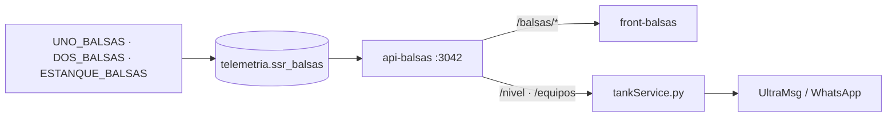

# Documentación técnica: SSR Las Balsas

## 1. Resumen

Panel de monitoreo del proceso de extracción de SSR Las Balsas: dos pozos que impulsan a un estanque, descarga a la red y tablero eléctrico de cada pozo. Envía alertas por WhatsApp (UltraMsg) si el nivel es crítico o si un equipo deja de enviar datos.

| Pieza | Carpeta | Tecnología |
|---|---|---|
| Backend (API) | `api-balsas/` | NestJS 11, TypeORM, PostgreSQL. Puerto **3042** |
| Frontend | `front-balsas/` | React 19, Vite, Bootstrap, Chart.js, SCADA en CSS |
| Alarma | `tankService.py`, `monitor_config.json` | Servicio unificado `MonitorEstanques` |



## 2. Señales

La escala se configura en un solo lugar, [sensores.config.ts](api-balsas/src/config/sensores.config.ts). **La API ya entrega unidades de ingeniería**: ni el frontend ni el monitor dividen.

| Equipo | Señal | Nombre en la API | ÷ | Unidad |
|---|---|---|---|---|
| ESTANQUE_BALSAS | `estanque` | `estanque` | 100 | m |
| ESTANQUE_BALSAS | `caudal_estanque` | `caudal_descarga` | 10 | l/s |
| ESTANQUE_BALSAS | `totalizador_descarga` | `totalizador_descarga` | 10 | m³ |
| ESTANQUE_BALSAS | `solar_estanque` | `solar` | 1000 | V |
| UNO_BALSAS | `caudal` (aún no llega) | `pozo_1_caudal` | 10 (supuesto) | l/s |
| DOS_BALSAS | `caudal` | `caudal` | 10 | l/s |
| DOS_BALSAS | `presion` | `presion` | 10 | bar |
| DOS_BALSAS | `totalizador` | `totalizador` | 10 | m³ |
| DOS_BALSAS | `bomba`, `automatico`, `manual` | `pozo_2_bomba`, `pozo_2_automatico`, `pozo_2_manual` | 1 | 0/1 |
| UNO/DOS_BALSAS | `L1N`…`L3N`, `L1L2`…`L3L1` | `pozo_N_L1N`, … | 100 | V |
| UNO/DOS_BALSAS | `I1`…`I3` | `pozo_N_I1`, … | 100 | A |

Las escalas salen de los datos reales de `datos.json`:

- 41452 → 414,52 V y 1952 → 19,52 A son coherentes con un motor trifásico de unos 11 kW.
- El caudal (÷10) cuadra con el avance de su totalizador (÷10): unos 12 l/s en ambos, tanto en impulsión como en descarga (unos 2,5 l/s).
- La potencia hidráulica de 13,3 l/s a 6,7 bar es unos 8,9 kW, consistente con la eléctrica.

**Caudal del Pozo 1:** el caudalímetro existe, pero `UNO_BALSAS--slave.caudal` todavía no llega. El diagrama ya tiene su FIT-03, que muestra `--` hasta recibir el primer dato; no requiere cambios ni despliegue adicional.

**Señales sin usar:** `DOS_BALSAS--slave.AIB17:2` y `AIB17:3` (valor 1). No se sabe qué representan.

## 3. API

Rutas sin prefijo: el `/balsas` lo agrega el proxy, como en los demás sitios. Respuestas de error: `{ success: false, statusCode, message }`. Caché de 60 s en todas las rutas GET.

| Ruta | Parámetros | Devuelve |
|---|---|---|
| `GET /snapshot` | — | `{ snapshot, equipos, tiempo_vaciado, nivel_alerta, nivel_maximo }` |
| `GET /equipos` | — | Último dato por equipo, con la forma que lee el monitor |
| `GET /nivel`, `/caudal`, `/presion`, `/caudal_descarga`, `/solar` | `start`, `end` (AAAA-MM-DD) o `limit` (100 por defecto, tope 5000) | `[{ time, value }]` |
| `GET /voltaje` | `pozo`, `tipo=linea\|fase` (línea por defecto), más rango o `limit` | `{ L1L2: [...], ... }` |
| `GET /corriente` | `pozo`, más rango o `limit` | `{ I1: [...], ... }` |
| `GET /totalizador`, `/totalizador_descarga` | `start`, `end` (obligatorios) | Consumo por día, m³ |
| `GET /horometro` | `pozo`, `start`, `end` (obligatorios) | Minutos de operación por día |

Valores derivados (no vienen de un sensor):

- `pozo_1_bomba`: UNO_BALSAS no tiene señal de bomba, se deduce de `I1 > 1 A`.
- `horometro`: tiempo con `I1 > 1 A`. Cada muestra vale hasta la siguiente, con tope de 5 min para no contar los cortes de comunicación.
- `tiempo_vaciado`: regresión Theil-Sen de los últimos 20 min. Distingue `vaciado`, `llenado` y `estable` (banda muerta de 1 mm/min).

**Zona horaria:** `mt_time_2` guarda hora de Chile sin zona. Los rangos comparan contra esa hora local y la salida se convierte con `AT TIME ZONE 'America/Santiago'`, así que no depende de la zona de Node ni de la sesión de BD. Se evita el problema documentado en Zuñiga (hallazgo 3).

La API es de solo lectura: a diferencia de otros sitios, no usa tabla `*_daily_metrics`. Los totales diarios se calculan con sondeos por índice.

## 4. Alarma

`tankService.py` es copia exacta de `MonitorEstanques/monitorEstanques.py` y está registrada en `sincronizar.py`. Ver [DEPLOY_MONITOREO.md](../DEPLOY_MONITOREO.md).

| Alerta | Condición | Destino |
|---|---|---|
| Nivel crítico | Nivel < `nivel_alerta` y no se está llenando. Incluye tiempo de vaciado. | `API_TO` (cliente) |
| Desconexión | Estanque o un pozo más de 30 min sin datos. Un aviso por equipo y otro al recuperarse. | `API_TO_ADMIN` |
| API caída | 5 ciclos seguidos sin respuesta | `API_TO_ADMIN` |

El estanque se vigila por `/nivel`. Por eso `monitor_config.json` lo ignora en `/equipos` y no se avisa dos veces.

## 5. Despliegue

1. **Índice** (una vez, a mano): `api-balsas/migrations/add-performance-indexes.sql`.
2. **API:** copiar `api-balsas/env.example` como `.env` y completar. `npm install && npm run build && pm2 start ecosystem.config.js`.
3. **Proxy:** publicar `/balsas` hacia el puerto 3042, como los demás sitios (esa configuración no está en este repositorio).
4. **Frontend:** `npm install && npm run build` en `front-balsas/` y servir `dist/` en `/balsas/`.
5. **Alarma:** copiar `tankService.py`, `monitor_config.json` y `requirements.txt` al servidor, crear `.env` desde `env.example` y verificar con:
   ```bash
   python tankService.py --una-vez --sin-enviar
   ```

Para desarrollo local, `VITE_API_URL=http://localhost:3042 npm run dev` y abrir `/balsas/`.

## 6. Por confirmar con el cliente

| Tema | Valor actual (provisorio) | Dónde se cambia |
|---|---|---|
| Altura máxima del estanque | 5 m | `NIVEL_MAXIMO` en `.env` de la API |
| Nivel crítico | 2 m | `NIVEL_ALERTA` en `.env` de la API y `nivel_alerta` en `monitor_config.json` |
| Nivel de rebalse | Sin alerta | `nivel_rebalse` en `monitor_config.json` |
| Escala de `UNO_BALSAS--slave.caudal` | ÷10, igual que el Pozo 2. Confirmar con el primer dato real. | `sensores.config.ts` |
| Ubicación de PI-01 | Ramal del Pozo 2, porque lo reporta DOS_BALSAS. Si va en la línea común, mide también al Pozo 1. | `ScadaDiagram.tsx` |
| "UNO" y "DOS" corresponden a Pozo 1 y Pozo 2 | Supuesto | `sensores.config.ts`, `balsas.ts` |
| Significado de `AIB17:2` y `AIB17:3` | Sin mostrar | `sensores.config.ts` |

El espejo de agua de los pozos es solo un dibujo: no hay sensor de nivel freático.
