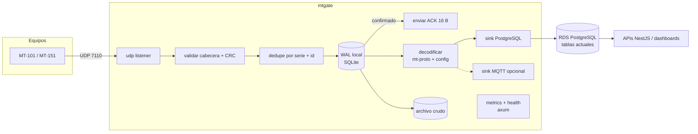

# Arquitectura: `mtgate`, receptor MT compatible en Rust

Propuesta, 2026-11-19. El protocolo está en [PROTOCOLO.md](PROTOCOLO.md) y el plan general en [PLAN_MIGRACION_INVENTIA.md](PLAN_MIGRACION_INVENTIA.md).

## 1. Objetivo y alcance

Reemplazar `mt_opc.exe` en lo que usamos hoy, con un binario que corra en Linux (y en Windows o macOS si hace falta), **sin tocar los equipos ni las APIs**.

Requisitos:

1. Recibir por UDP 7110 los mensajes espontáneos de MT-101 y MT-151 en modo `dynamic`.
2. Responder la confirmación de 16 bytes.
3. Decodificar con la configuración actual (bloques, formatos, `dreg_order`, alias).
4. Escribir en PostgreSQL **las mismas tablas y filas** que hoy (`<tabla>(mt_name, mt_value, mt_time, mt_quality)`), con el mismo nombre de tag y el mismo formato de valor.

No incluye, al menos en la v1: OPC DA/UA, CSV, configuración remota, firmware ni cifrado `secure`.

Lo que **mejora** respecto de MTDP:

- **No se pierden datos.** Solo confirma después de dejar la trama en almacenamiento durable.
- Archivo crudo de todas las tramas, para re-decodificar, auditar y comparar.
- Los equipos desconocidos van a una tabla propia en lugar de fallar.
- Métricas y salud de cada equipo (última trama, errores), que sirven de base para el monitor de desconexión.
- Configuración versionada en git, sin credenciales.

## 2. Por qué Rust

- **Seguridad de memoria al parsear entrada no confiable.** Cualquiera puede mandar UDP al puerto 7110.
- **Un binario estático** (musl) de pocos MB, sin runtime: imagen Docker `scratch` o servicio systemd.
- **Compila para Linux x86_64/arm64, Windows y macOS** con el mismo código. Esto responde a "cualquier sistema operativo".
- **`tokio` + `sqlx`** resuelven la parte de red y base de datos con poco código. El volumen (35 equipos, unos cientos de tramas por minuto) no exige rendimiento, pero el bajo consumo permite usar la instancia más chica.

Lo que cuesta: el equipo hoy trabaja en TypeScript y Python, así que la curva es más larga. Para mitigarlo, el núcleo del protocolo es una librería pequeña y pura, con pruebas basadas en tramas reales; el resto es código de integración bastante estándar.

## 3. Componentes



### Workspace Cargo

| Crate | Tipo | Responsabilidad |
|---|---|---|
| `mt-proto` | lib, sin I/O | Cabecera, CRC (`init = id`), ACK, Modbus RTU, mensajes `'z'`/`'y'`/`'C'`, timestamp empaquetado, conversión `int2/long4/float4/bool/signed/dreg_order`. Probado con tramas reales y con *fuzzing* (`cargo-fuzz`) |
| `mt-config` | lib | Modelo `Device { serial, name, slave, table, logger_table, blocks[], aliases }`. Importador de `sample.xml` + `mt_aliases` a `devices.toml` |
| `mtgate` | bin | Servidor: UDP, estado por equipo, WAL, ACK, sinks, métricas y API de administración |
| `mt-tools` | bin | `decode` (hex o pcap a filas), `replay` (reenvía capturas), `tee` (relay UDP para el modo sombra), `diff` (compara contra lo que insertó MTDP), `sim` (equipo falso que emite eventos `'z'`) |

Crates externos previstos: `tokio`, `sqlx` (postgres + sqlite), `serde` + `toml` + `quick-xml` (importador), `tracing`, `metrics` + `metrics-exporter-prometheus`, `axum`, `pcap-file` (herramientas).

## 4. Flujo de una trama

1. **Recepción.** `recv_from`; se descartan las tramas de menos de 16 bytes o más de 1.500.
2. **Cabecera.** Se valida el CRC (valor inicial = id de trama) y, si el largo indica contenido, el CRC Modbus.
3. **Identificación.** `serie = bytes 4..8`. Se actualiza `last_addr` (IP:puerto) y `last_seen`.
4. **Dedupe.** Ventana de 8 ids por equipo, como MTDP. Los duplicados **se confirman pero no se procesan**.
5. **Durabilidad.** Se escribe la trama cruda en el WAL local (SQLite en modo WAL, una fila por trama: hora, IP:puerto, bytes). Es el único punto que bloquea la confirmación.
6. **ACK.** Se envía según `ack_policy`:
   - `after_wal` (por defecto): no se pierde nada aunque RDS esté caído.
   - `after_db`: equivale a `no_ack` de MTDP.
   - `immediate`: el comportamiento actual de MTDP, solo para pruebas.
7. **Decodificación y escritura**, en una tarea aparte:
   - Se decodifica con la configuración del equipo y se escribe en PostgreSQL por lotes, en una transacción.
   - La trama se marca como entregada en el WAL. Si falla, se reintenta con *backoff*.
   - El WAL hace de cola persistente, así que un corte de RDS no pierde datos.
8. **Equipos desconocidos.** Se guarda la trama cruda y su decodificación genérica en `mt_unknown(serial, addr, mt_name, mt_value, mt_time, raw)` y se emite una métrica o alerta.

## 5. Compatibilidad con lo que existe

Para que las APIs no noten el cambio:

- **Tabla destino:** `odbc_read_table` / `odbc_logger_table` de cada equipo, y si no hay, `mt_read` / `mt_logger`. Las columnas son las de hoy.
- **Nombres:** `<equipo>--<esclavo>.<tag>`, donde el tag es el alias si existe y si no, `REG<n>`, `REGF<n>`, `REGL<n>`, `AI<n>` o `AIB<n>:<bit>` según el formato configurado.
- **Valor:** texto. Enteros sin decimales; `float4` con `%f` (6 decimales); `bool` como `0`/`1`. Se confirma con `mt-tools diff` contra datos reales antes del corte.
- **Hora:** `YYYY-MM-DD HH:MM:SS.mmm`, tomada de la trama (`timestamp="data"`) o del servidor, según la configuración.
- **`mt_quality = '1'`.**
- **Triggers existentes** (como el de riego en Zagal): siguen funcionando porque los inserts son iguales. Un insert rechazado **no se pierde**: queda pendiente en el WAL y genera una alerta.

## 6. Configuración

`devices.toml`, generado una vez con `mt-tools import sample.xml mt_aliases` y versionado en git. Las credenciales van por variables de entorno.

```toml
[server]
udp_bind   = "0.0.0.0:7110"
ack_policy = "after_wal"
timestamp  = "data"          # data | system | data_utc | data_local

[database]
url_env = "MTGATE_DATABASE_URL"

[[device]]
name   = "SSR_RANGUIL"
serial = "151.22.40.66"      # o 1109923479
slave  = { id = 1, name = "slave" }
table  = "SSR_RANGUIL"       # read y logger
blocks = [
  { space = "registers", address = 832, format = "float4", dreg_order = "lo_hi" },
  { space = "analog_inputs", address = 17, size = 3, format = "bool" },
]
aliases = { "REGF832" = "caudal", "AIB17:1" = "bomba" }
```

La configuración se recarga con `SIGHUP` o desde la API, sin reiniciar. Dar de alta un equipo es agregar un bloque y abrir un PR.

## 7. Observabilidad y administración

- `/metrics` en formato Prometheus: tramas por equipo, errores de CRC, duplicados, equipos desconocidos, profundidad del WAL y latencia hacia la base.
- `/health`: lo usan systemd y Docker.
- `/devices`: serie, nombre, última trama, IP:puerto y contadores. Es la fuente natural del monitor de desconexión por WhatsApp (ver `CATALOGO_FEATURES.md`).
- `/frames?serial=…`: últimas tramas crudas decodificadas, para diagnosticar sin Wireshark.

## 8. Despliegue

- **Binario estático** `x86_64-unknown-linux-musl` + unidad systemd con `Restart=always` y `AmbientCapabilities=CAP_NET_BIND_SERVICE` (no hace falta, porque 7110 es mayor que 1024).
- **Imagen Docker `FROM scratch`** de unos 10 MB, con un volumen para el WAL.
- **La misma instancia Linux** que hospede las APIs, nginx y pm2. Se reasigna la **IP elástica** actual de AWS a esa instancia y los equipos no se tocan.
- El WAL ocupa poco (unos cientos de MB al año como mucho) y se rota por antigüedad una vez entregado. El archivo crudo puede vivir en PostgreSQL (`mt_raw`, particionada por mes) o en archivos diarios comprimidos.

## 9. Validación y corte

1. **Corpus de referencia.** Capturas de UDP 7110 del servidor actual (`pktmon` o `tshark`) más las tramas del simulador oficial (`tools/mtproto_probe.py`), convertidas en pruebas de `mt-proto`.
2. **`mt-tools diff`.** Decodifica la captura y compara fila por fila con lo que MTDP insertó en RDS ese mismo período. La meta es 0 diferencias.
3. **Modo sombra** durante 2 a 4 semanas:
   - La IP elástica pasa a Linux, donde `mt-tools tee` reenvía cada datagrama a MTDP en Windows, que sigue respondiendo las confirmaciones.
   - `tee` entrega además una copia a `mtgate` con `ack_policy = "never"`, que escribe en tablas `_shadow`.
   - La comparación es automática y diaria.
4. **Corte.** `tee` deja de reenviar a Windows y `mtgate` pasa a `after_wal` y a las tablas reales. **Vuelta atrás:** reactivar el reenvío.
5. Apagar Windows.

## 10. Etapas de desarrollo

| Etapa | Entregable | Depende de |
|---|---|---|
| 0 | Capturas de tráfico real (1 a 2 semanas) y respuestas a §9 de PROTOCOLO.md | Acceso al Windows actual |
| 1 | `mt-proto`: cabecera, ACK, Modbus y evento `'z'`, con pruebas sobre las tramas del simulador | — (se puede empezar ya) |
| 2 | `mt-config` + importador de `sample.xml`/`mt_aliases` | — |
| 3 | `mtgate`: UDP, WAL, ACK y sink PostgreSQL; `mt-tools decode/replay/diff` | 1, 2 |
| 4 | Logger `'y'`, `'C'` y lo que muestren las capturas; tabla de desconocidos | 0 |
| 5 | `mt-tools tee`, modo sombra y comparación diaria | 3 |
| 6 | Métricas, API de administración, Docker y systemd; corte | 5 |
| 7 (opcional) | Escritura hacia equipos (`mt_write` → función 6/0x10 a la última IP:puerto conocida, esperando ACK y respuesta); sink MQTT | Decidir si hace falta |

## 11. Riesgos

- **Variantes del protocolo que no aparecen en el pseudocódigo** (firmwares viejos, equipos con contraseña). Se mitiga con un corpus real amplio y con el archivo crudo, que permite re-decodificar después.
- **Formateo de valores que difiera en detalles** (redondeo de `float4`, signo). Lo detecta `mt-tools diff` antes del corte.
- **Escritura hacia equipos detrás de NAT:** solo es posible mientras el NAT del operador mantenga abierta la última IP:puerto. Es igual que hoy y no afecta la v1.
- **Curva de Rust en el equipo.** El núcleo es pequeño y está bien acotado; hay que documentar y probar a fondo.
