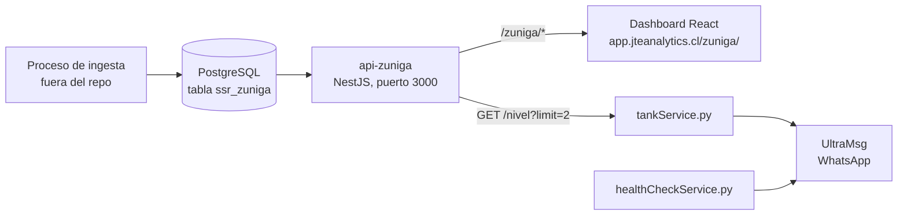

# Documentación técnica: SSR Zuñiga

## 1. Resumen

Es un panel de monitoreo de la estación de bombeo Zuñiga. Muestra el estado de la bomba, los dos estanques (350 m³ y 2 m³), el caudal, la presión, el nivel freático, el horómetro y el totalizador. También envía alertas por WhatsApp (vía UltraMsg).

Tiene tres piezas:

| Pieza | Carpeta | Tecnología |
|---|---|---|
| Frontend (dashboard) | `DashboardZunigaReact/` | React 19, Vite, Bootstrap, Chart.js |
| Backend (API) | `api-zuniga/` | NestJS 11, TypeORM, PostgreSQL (AWS RDS) |
| Servicios de alerta | `tankService.py`, `healthCheckService.py` | Python, `requests` |

---

## 2. Arquitectura general

**Flujo de datos del dashboard:**

1. Al abrir la página, `Home.tsx` pide datos y repite la carga cada **120 s**.
2. `/snapshot` entrega el estado actual de todas las variables.
3. `/nivel`, `/nivel2` y `/caudal` entregan las series del día actual (`start` = `end` = hoy en America/Santiago).
4. `/totalizador` y `/horometro` entregan valores diarios. Se guardan en `localStorage` mediante `fetchWithCache`.
5. El backend tiene una caché de 60 s en todas las rutas GET (`CacheInterceptor`).

---

## 3. Componentes y endpoints

### 3.1 Frontend

| Archivo | Función |
|---|---|
| [main.tsx](DashboardZunigaReact/src/main.tsx) | Monta la app con `BrowserRouter` y Bootstrap. |
| [App.tsx](DashboardZunigaReact/src/App.tsx) | Única ruta: `/zuniga/` → `Home`. |
| [Home.tsx](DashboardZunigaReact/src/pages/Home.tsx) | Página principal. Pide los datos y elige la vista de escritorio (ancho ≥ 992 px) o la móvil. |
| [ScadaDiagram.tsx](DashboardZunigaReact/src/components/ScadaDiagram.tsx) | Diagrama animado de la estación (pozo, bomba, tuberías, estanques). |
| [Tank.tsx](DashboardZunigaReact/src/components/Tank.tsx), [Pipe.tsx](DashboardZunigaReact/src/components/Pipe.tsx), [Pump.tsx](DashboardZunigaReact/src/components/Pump.tsx), [Instruments.tsx](DashboardZunigaReact/src/components/Instruments.tsx) | Piezas del diagrama: estanque, tubería, bomba, manómetro, válvula y caudalímetro. |
| [States.tsx](DashboardZunigaReact/src/components/States.tsx) | Panel "Estado Tablero": modo, bomba y falla. |
| [GraphCard.tsx](DashboardZunigaReact/src/components/GraphCard.tsx) | Gráfico con Chart.js. Líneas para nivel y caudal; barras para horómetro y totalizador. Nivel y caudal tienen selector de fecha. |
| [Level.tsx](DashboardZunigaReact/src/components/Level.tsx) | Anillo con el porcentaje de nivel (vista móvil). |
| [Card.tsx](DashboardZunigaReact/src/components/Card.tsx) | Tarjeta con título y filas "etiqueta: valor". |
| [Navbar.tsx](DashboardZunigaReact/src/components/Navbar.tsx) | Muestra la hora de la última lectura con color de frescura y un botón de pantalla completa. |
| [fetchWithcache.tsx](DashboardZunigaReact/src/components/fetchWithcache.tsx) | Caché en `localStorage` para totalizador y horómetro. Guarda 15 días y nunca guarda el día actual. |
| [ExportModal.tsx](DashboardZunigaReact/src/components/ExportModal.tsx), [ExportToExcel.tsx](DashboardZunigaReact/src/components/ExportToExcel.tsx) | Exporta datos a Excel (`.xlsx`). Ver hallazgo 1. |
| [Error.tsx](DashboardZunigaReact/src/pages/Error.tsx), [Loading.tsx](DashboardZunigaReact/src/pages/Loading.tsx) | Pantallas de error (si no llega el snapshot) y de carga. |

**Sin uso en la aplicación:** `pages/Chart.tsx`, `components/CaudalChart.tsx` (solo lo usa `Chart.tsx`) y `components/BurgerMenu.tsx`.

### 3.2 Backend

Estructura: `main.ts` (arranque, CORS, filtro de errores), `app.module.ts` (módulos y caché), `config/database.config.ts` (conexión a PostgreSQL) y `metrics/` (controlador, servicio, entidad y DTO).

Las rutas no tienen prefijo. El prefijo `/zuniga` lo agrega el servidor o proxy que está delante (no está en el repo; ver sección 9).

| Ruta | Parámetros | Devuelve | Lo usa |
|---|---|---|---|
| `GET /snapshot` | ninguno | `{ snapshot: { nombre: { value, time } }, tiempo_vaciado, tiempo_vaciado_formatted }` | Home, Chart |
| `GET /nivel` | `start`, `end` (o `limit`, por defecto 100) | `[{ time, value }]` del estanque 350 m³ | Home, GraphCard, tankService (`limit=2`) |
| `GET /nivel2` | igual que `/nivel` | igual, del estanque 2 m³ | Home, GraphCard |
| `GET /caudal` | `start`, `end`. Sin rango: últimos 100 registros | `[{ time, value }]` | Home, GraphCard |
| `GET /totalizador` | `start`, `end` (obligatorios) | `[{ time: "AAAA-MM-DD", value }]` diario, en m³ | fetchWithCache |
| `GET /horometro` | `start`, `end` (obligatorios) | `[{ time: "AAAA-MM-DD", value }]` diario, en minutos | fetchWithCache |
| `GET /snapshot-cumpeo` | ninguno | Snapshot de la tabla `ssr_cumpeo` (sensor "NIVEL") | Nadie |

Los errores salen con esta forma: `{ success: false, statusCode, message }`.

---

## 4. Mapeo de variables

Variables del `snapshot` (`/snapshot`) y de las series:

| Variable | Origen | Dónde se muestra | Transformación | Unidad |
|---|---|---|---|---|
| `estanque` | snapshot y `/nivel` | Estanque 350 m³: tarjeta móvil, tanque SCADA, gráfico | Ninguna. El porcentaje es nivel ÷ 7 | m |
| `estanque_2` | snapshot y `/nivel2` | Estanque 2 m³: tarjeta móvil, tanque SCADA, gráfico | Ninguna. El porcentaje es nivel ÷ 2 | m |
| `caudal` | snapshot y `/caudal` | Tarjeta Bomba, caudalímetro FIT-01, gráfico | Ninguna | l/s |
| `freatico` | snapshot | Vista móvil, marca "NF" del pozo, placa SCADA | **÷ 100** en frontend | m |
| `presion` | snapshot | Vista móvil, manómetro PI-01, placa SCADA | **÷ 10** en frontend | bar |
| `horometro` (snapshot) | snapshot | Placa "Horómetro Total" | Minutos → horas y minutos | h m |
| `horometro` (serie) | `/horometro` | Gráfico de barras; su último valor es el "Horómetro" de hoy | Backend: último − primer valor del día. Frontend: minutos → HH:MM | HH:MM |
| `totalizador` (snapshot) | snapshot | Placa "Totalizador Total" | Ninguna (`toFixed(2)`) | m³ |
| `totalizador` (serie) | `/totalizador` | Gráfico de barras; su último valor es el "Totalizador diario" | Backend: último − primer valor del día | m³ |
| `bomba` | snapshot | Estado "Bomba" y animación de la bomba | `=== 1` → Encendida / Apagada | — |
| `falla` | snapshot | Estado "Estado" y color de la bomba | `=== 1` → Con falla / Sin falla | — |
| `automatico` | snapshot | Estado "Modo" | `=== 1` → Automático / Manual | — |
| `tiempo_vaciado_formatted` | snapshot | Placa "Tiempo de Vaciado" | Calculado en backend (sección 5) | HH h MM m SS s |
| `time` (de cada variable) | snapshot | Barra superior: la hora más reciente | Máximo de los `time`. Verde ≤ 10 min, amarillo ≤ 20 min, rojo > 20 min | fecha y hora |

---

## 5. Transformaciones y formateo

Esta sección indica dónde ocurre cada cálculo.

### 5.1 En el backend (antes de enviar)

| Qué | Dónde | Detalle |
|---|---|---|
| Quitar prefijo de nombres | [metrics.service.ts](api-zuniga/src/metrics/metrics.service.ts) (`getSnapshot`) | Quita `SSR_ZUNIGA--slave.` de cada nombre. |
| Texto a número | `metrics.service.ts` | `Number(...)` sobre `mt_value`, que la base guarda como texto. |
| Tiempo de vaciado | `metrics.service.ts` (`getSnapshot` y `getSnapshotCumpeo`) | Tasa = (nivel anterior − nivel actual) ÷ (tiempo actual − tiempo anterior), en m/s. Tiempo = nivel actual ÷ tasa, en segundos. Si el nivel no baja o no hay dos lecturas, devuelve 0 y "Llenando...". |
| Total diario | `metrics.service.ts` (`calculateAndCacheDaily`) | Último valor − primer valor del día, con SQL. El resultado se guarda en `ssr_zuniga_daily_metrics`. El día actual se recalcula en cada llamada. |
| Rango de fechas | `metrics.service.ts` (`normalizeDateRange`) | Arma el rango con medianoche UTC (`T00:00:00Z`), pero la base guarda hora chilena. El rango queda desfasado. Ver hallazgo 3. |
| Hora de salida | `metrics.service.ts` | Los `time` salen con `toISOString()` (UTC). Eso es correcto solo si el proceso de Node corre con zona `America/Santiago`. El código no la fija. |
| Límite por defecto | `metrics.service.ts` | Sin rango, `/nivel` y `/nivel2` devuelven 100 registros. `/caudal` también 100. |

### 5.2 En el frontend (después de recibir)

| Qué | Dónde | Detalle |
|---|---|---|
| Freático en metros | `Home.tsx` (vista móvil) y `ScadaDiagram.tsx` | `valor ÷ 100`. Supone que el valor llega en centímetros. |
| Presión en bar | `Home.tsx` (vista móvil) y `ScadaDiagram.tsx` | `valor ÷ 10`. Móvil con 1 decimal; SCADA con 2. |
| Horómetro total (SCADA) | `ScadaDiagram.tsx` (`formatMinutes`) | `H h M m`, a partir de minutos. |
| Horómetro (móvil) | `Home.tsx` | `horas:minutos h`, sin ceros a la izquierda. |
| Horómetro en gráfico | `GraphCard.tsx` (`minutesToHHMM`) | `HH:MM` en ejes y en el tooltip. |
| Porcentaje de nivel | `Level.tsx` y `Tank.tsx` | Nivel ÷ nivel máximo × 100. En `Tank.tsx` el relleno se limita entre 0 y 100 %. |
| Escala de gráficos | `Home.tsx` (props `nivelMax`) | Nivel 350 m³: 0–7 m, con línea de alarma en 2 m. Estanque 2: 0–2 m. Caudal: 0–50 l/s. |
| Divisor | `GraphCard.tsx` (prop `divisor`) | Existe, pero ningún componente lo pasa. Su valor es siempre 1. |
| Etiquetas de tiempo | `GraphCard.tsx` | Nivel y caudal: `HH:mm` (es-CL). Diarios: `AAAA-MM-DD`. |
| Caudal con decimales | `Card.tsx`, `ScadaDiagram.tsx` | `toFixed(2)` en tarjetas; `toFixed(1)` en el display del caudalímetro. |
| Velocidad de la animación | `ScadaDiagram.tsx` | `min(90, 16 + caudal × 1,1)`. Solo visual. |
| Agua en la tubería | `ScadaDiagram.tsx` | Hay agua si el nivel del estanque 350 m³ supera 0,4 m. Solo visual. |

### 5.3 En los servicios Python

`tankService.py` calcula el tiempo de vaciado con la misma fórmula que el backend. Lo muestra como HH:MM:SS con `utcfromtimestamp`, que vuelve a 00 después de 24 horas.

---

## 6. Alertas y servicios Python

### 6.1 `tankService.py`

- Consulta `/nivel?limit=2` de la API pública. Tiene un timeout de 20 s y reintenta 2 veces.
- Vigila solo el estanque 350 m³ (`SSR_ZUNIGA--slave.estanque`).
- Ciclo: cada **1 minuto** si todo está normal. Si hay alerta, espera `INTERVALO_MINUTOS` (por defecto 5).

| Alerta | Condición | Destino |
|---|---|---|
| Nivel crítico | El nivel baja y está bajo `NIVEL_ALERTA` (por defecto 2 m). Incluye tiempo estimado de vaciado. | Grupo `API_TO` |
| Desconexión | La última lectura tiene más de 30 minutos. | Grupo admin `API_TO_ADMIN` |
| API caída | 5 ciclos seguidos sin respuesta válida. Se avisa una vez y luego se avisa la recuperación. | Grupo admin |

- Log: `logs_ZUNIGA.txt`.

### 6.2 `healthCheckService.py`

- Envía "todo OK" a las **00:00** y a las **12:00** (hora local del servidor).
- Log: `logs_health_check.txt`.

### 6.3 Variables de entorno

| Variable | Usada por | Para qué |
|---|---|---|
| `API_URL`, `API_TOKEN`, `API_TO`, `API_TO_ADMIN` | Servicios Python (archivo `.env` raíz) | Envío de mensajes por UltraMsg. |
| `INTERVALO_MINUTOS`, `NIVEL_ALERTA` | `tankService.py` | Intervalo con alerta y umbral de nivel crítico. |
| `DB_HOST`, `DB_PORT`, `DB_USER`, `DB_PASS`, `DB_NAME` | Backend (archivo `api-zuniga/.env`) | Conexión a PostgreSQL. |
| `PORT` | Backend | Puerto HTTP. Por defecto 3000. |

---

## 7. Despliegue y operación

- **Backend:** `npm run build` genera `dist/main.js`. PM2 lo corre con [ecosystem.config.js](api-zuniga/ecosystem.config.js): 2 instancias, nombre `api-zuniga-pg`, reinicio automático.
- **Errores fatales del backend:** se escriben en `fatal-crashes.log` y el proceso termina; PM2 lo vuelve a levantar.
- **Conexión a la base:** pool de 5 conexiones, timeout de consulta de 10 s, SSL sin verificar de certificado. `synchronize` está desactivado.
- **Frontend:** Vite con `base: "/zuniga/"`. `npm run build` genera `dist/`. Las URLs del backend están fijas en el código (`https://app.jteanalytics.cl/zuniga/...`).
- **Migración manual:** [add-performance-indexes.sql](api-zuniga/migrations/add-performance-indexes.sql) crea el índice `(mt_name, mt_time_2 DESC)` sobre `ssr_zuniga`. Se ejecuta a mano en PostgreSQL.

---

## 8. Hallazgos y puntos a revisar

Ordenados por importancia.

1. **Corregido: exportación a Excel.** [ExportToExcel.tsx](DashboardZunigaReact/src/components/ExportToExcel.tsx) pedía rutas que no existen (`nivelestanque1`, `nivelestanque2`) y enviaba `fechaInicio`/`fechaFin`, que el backend ignora. Ahora usa `nivel`, `nivel2`, `start` y `end`. La fecha por defecto también se calcula en hora de Chile. Antes, nivel daba 404, horómetro y totalizador daban 500, y caudal traía los últimos 100 registros sin filtrar. El frontend compila (`tsc -b`). No probé la descarga contra el servidor.
2. **Corregido: `pages/Chart.tsx`** tenía los mismos parámetros incorrectos. Ahora usa `start` y `end`. La página no tiene ruta activa.
3. **Pendiente: rango de fechas y zona horaria del backend.** Los timestamps se guardan en hora chilena. El backend los devuelve en UTC con `toISOString()`. Eso es correcto solo si el proceso de Node corre con zona `America/Santiago`, y el código no la fija. Hay dos problemas:
   - Si Node corre en Chile: `normalizeDateRange` arma el rango con medianoche UTC. Al enviarlo a PostgreSQL, el desfase lo adelanta 3 o 4 horas. Por ejemplo, el "día 25" empieza a las 21:00 del 24.
   - Si Node corre en UTC: los datos salen con "Z" pero con hora chilena, así que el dashboard los muestra 3 horas antes de su hora real.
   - Además, `todayStr` en `calculateAndCacheDaily` usa la fecha UTC. Entre las 21:00 y las 24:00 de Chile, el total del día actual no se recalcula y puede quedar desactualizado.
   - `tankService.py` también compara con UTC, así que depende de lo mismo.

   **Propuesta:** fijar `TZ=America/Santiago` al arrancar el backend, armar el rango con medianoche local y calcular `todayStr` en hora de Chile. No lo he aplicado porque cambia el backend en producción. Confirmar antes si lo hago.
4. **Sin validación de parámetros.** `main.ts` no registra `ValidationPipe`, así que las validaciones de `DateRangeDto` no se aplican. Una fecha inválida produce error 500 en vez de 400.
5. **CORS abierto.** `main.ts` permite cualquier origen (`origin: '*'`).
6. **Código sin uso.** `Chart.tsx`, `CaudalChart.tsx`, `BurgerMenu.tsx` y el endpoint `/snapshot-cumpeo` (con la tabla `ssr_cumpeo`). Confirmar si algo externo lo usa antes de borrarlo.
7. **Conversiones duplicadas y un divisor sin uso.** La prop `divisor` de `GraphCard` nunca se pasa, y `prompt.txt` describe una división por 100 que ya no existe. Las conversiones de freático y presión están repetidas en `Home.tsx` y `ScadaDiagram.tsx`.
8. **Fórmula de vaciado en dos lugares.** Está en Node (backend) y en Python (`tankService.py`). Si cambia una, hay que cambiar la otra.
9. **"Llenando..." engaña.** También aparece cuando el nivel está estable, no solo cuando el estanque se está llenando.
10. **Tabla sin definición en el repo.** `ssr_zuniga_daily_metrics` se usa en el código, pero no tiene `CREATE TABLE` en el repositorio.
11. **Clave primaria de la entidad.** `Telemetria` declara solo `mt_time_2` como clave primaria. Lo más probable es que la clave real incluya `mt_name`. No lo pude verificar en la base.
12. **Detalles de interfaz.**
    - `Home.tsx` tiene un `console.log(cleanDate)` de depuración.
    - `Error.tsx` muestra "Error 404" aunque el fallo sea de carga.
    - El horómetro se muestra con formato distinto en la vista móvil y en la SCADA.
13. **Monitor parcial.** `tankService.py` vigila solo el estanque de 350 m³, no el de 2 m³.

---

## 9. Lo que no pude verificar

- El contenido real de la base de datos y los nombres exactos de los sensores. Se asumen a partir del código.
- Cómo el servidor o proxy que atiende `app.jteanalytics.cl` quita el prefijo `/zuniga` y reenvía al backend. No está en el repositorio.
- El proceso que escribe los datos en `ssr_zuniga` (ingesta). Está fuera de este repositorio.
- La zona horaria con que corre el proceso de Node en producción. Hay que revisarla en el servidor (por ejemplo, con `date` o con `TZ` en el entorno de PM2). El código no la fija.
- El estado de PM2 en producción.
